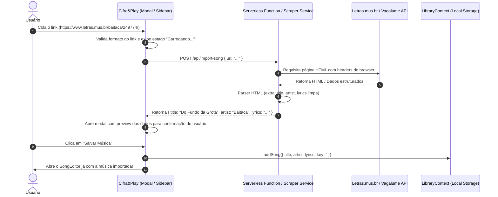

# Plano de Implementação: Importação Automática de Músicas por Link (Letras.mus.br / Vagalume)

Este documento avalia a viabilidade, define a arquitetura técnica, os campos necessários e o plano de implementação para permitir a criação automática de letras/músicas no **Cifra&Play** a partir de um link da web (como `https://www.letras.mus.br/baitaca/249774/`).

---

## 1. Viabilidade: É possível implementar?

**Sim, é 100% possível e viável.**

No entanto, há uma particularidade técnica importante:
- O **Cifra&Play** é uma Single Page Application (Vite + React) executada diretamente no navegador do usuário.
- Se o navegador tentar fazer um `fetch('https://www.letras.mus.br/...')` direto, ele será bloqueado por políticas de **CORS** (Cross-Origin Resource Sharing) e mecanismos antibot (como Cloudflare, que retorna status HTTP 403 / Forbidden para requisições diretas de scrapers).
- **Soluções arquiteturais recomendadas:**
  1. **Solução A (Híbrida / Mais Robusta - Serverless / Proxy Edge):** Criar uma API route leve (Vercel Serverless Function em `/api/scrape-lyrics` ou Cloudflare Worker) que busca o HTML do link e extrai os dados, devolvendo um JSON limpo para o app.
  2. **Solução B (API Oficial Vagalume / Extrator URL):** Como muitas músicas brasileiras estão catalogadas com APIs públicas abertas (ex: Vagalume API), o sistema pode extrair o nome do artista e música da URL (ex: `/baitaca/249774/` -> artista: *Baitaca*, faixa: *Do Fundo da Grota*) e consultar metadados e letras via API oficial aberta, ou utilizar proxies CORS públicos/próprios (como allorigins / corsproxy) para fallback.

---

## 2. Quais campos o sistema precisa?

Analisando a estrutura do modelo no [`LibraryContext.jsx`](file:///c:/Users/Robson/source/cifra-play/src/store/LibraryContext.jsx) e no [`SongEditor.jsx`](file:///c:/Users/Robson/source/cifra-play/src/features/SongEditor.jsx), o modelo de uma música no **Cifra&Play** é composto por:

| Campo | Tipo | Obrigatório | Descrição |
| :--- | :--- | :---: | :--- |
| `id` | `string` | Sim | Gerado pelo app (`manual_${Date.now()}`) |
| `title` | `string` | Sim | Nome da canção (Ex: *"Do Fundo da Grota"*) |
| `artist` | `string` | Sim | Nome do artista/banda (Ex: *"Baitaca"*) |
| `lyrics` | `string` | Sim | Letra completa ou letra cifrada formatada com quebras de linha |
| `key` | `string` | Não | Tom da música (Ex: `"G"`, `"D"`, `"Am"`). *Pode vir vazio ou sugerido* |
| `style` | `string` | Não | Estilo musical / Ritmo (Ex: `"Vanera"`, `"Gaúcha"`, `"Sertanejo"`) |
| `columns` | `number` | Não | Número de colunas no palco (padrão `1` ou `2`) |
| `audioUrl` | `string` | Não | Link ou Blob de áudio auxiliar (opcional) |
| `fontSize` | `number` | Não | Tamanho base de visualização (opcional) |

---

## 3. Como extrair estes campos da URL do Letras.mus.br?

Análise do link fornecido:
`https://www.letras.mus.br/baitaca/249774/`

### A. Extração via URL e Metadados do HTML
Ao analisar a página do Letras.mus.br:
1. **Slug do Artista na URL:**
   - O primeiro segmento após o domínio (`/baitaca/`) traz o artista em formato slug.
2. **Tags Open Graph e Schema.org (JSON-LD) no HTML:**
   - O Letras.mus.br embute metadados estruturados:
     - `<meta property="og:title" content="Do Fundo da Grota - Baitaca" />`
     - `<meta property="og:description" content="..." />`
     - `<title>DO FUNDO DA GROTA - Baitaca - LETRAS.MUS.BR</title>`
     - Tag JSON-LD `<script type="application/ld+json">` contendo `MusicComposition` ou `MusicRecording` com `name` e `byArtist`.
   - **Título da Música (`title`):** Obtido do `<h1>` principal ou de `og:title` separando pelo hífen `-`.
   - **Artista (`artist`):** Obtido do `<h2>` subtítulo do artista ou da tag de autor.
3. **Corpo da Letra (`lyrics`):**
   - O Letras.mus.br renderiza a letra dentro de um container com blocos `<p>` e quebras `<br/>`.
   - A extração converte `<p>` e `<br/>` em quebras de linha reais (`\n` e `\n\n`), mantendo as estrofes exatas.
4. **Tom (`key`):**
   - Em links de letras puras, o tom vem vazio (usuário escolhe no editor ou lista). Em links do Cifra Club, o tom é capturado automaticamente do seletor de tom (`.cifra-tom` ou `span#cifra_tom`).

---

## 4. Conformidade com as Regras de Renderização do Cifra&Play

O sistema possui regras internas rígidas de processamento de texto no [StageMode.jsx](file:///c:/Users/Robson/source/cifra-play/src/features/StageMode.jsx) e [SongEditor.jsx](file:///c:/Users/Robson/source/cifra-play/src/features/SongEditor.jsx):

### Regra 1: Separação de Estrofes (`\n\n`) e Linhas (`\n`)
- No motor do palco, as estrofes são divididas por:
  ```javascript
  const stanzas = text.split(/\n\s*\n/);
  ```
- **Requisito do Scraper:** Cada parágrafo/estrofe do site **DEVE** ser separado por uma linha em branco dupla (`\n\n`). Linhas consecutivas da mesma estrofe devem ser separadas por quebra simples (`\n`). O parser **NUNCA** deve juntar tudo em uma única linha ou usar `<br>` HTML.

### Regra 2: Notação de Acordes e Cifras (`[Acorde]`)
- O motor de renderização do Cifra&Play colore e destaca cifras usando regex de colchetes:
  ```javascript
  const parts = line.split(/(\[[^\]]+\])/g);
  // se casar com /^\[[^\]]+\]$/, aplica a classe .chord (laranja/destaque)
  ```
- **Requisito:** 
  - Se for importada letra pura (Letras.mus.br), o texto vem limpo sem tags estranhas.
  - Se for importada cifra (Cifra Club ou cifras do Letras), os acordes sobrepostos às palavras **DEVEM** ser encapsulados em colchetes embutidos ou em linha própria: Exemplo: `[G] Fui criado na campanha [D7] em rancho de barro e capim`.

### Regra 3: Higienização de Caracteres Especiais
- Remover tags HTML residuais (`<span>`, `<font>`, etc.).
- Converter entidades HTML (`&nbsp;` -> espaço, `&amp;` -> `&`, `&#39;` -> `'`).
- Trim em cada linha individual para evitar desalinhamento nas colunas e na paginação horizontal do palco.


---

## 4. Arquitetura Recomendada



---

## 5. Passos de Implementação (Roadmap)

### Fase 1: Endpoint de Scraping / Proxy Seguro
- Criar a função servidora (ex: `api/import-song.js` no Vercel, já que o repositório possui `vercel.json`).
- Utilizar `cheerio` para parsear o HTML do Letras.mus.br ou Cifra Club.
- Fallback para API do Vagalume caso o usuário cole apenas nome ou caso o Letras aplique restrição de IP.

### Fase 2: Interface no Front-end (Cifra&Play)
- **Botão na Sidebar e Barra Inferior:**
  - Adicionar opção *"Importar por Link"* ao lado do botão de adicionar música (`+`).
- **Modal de Importação ("Importar Letra"):**
  - Campo de entrada com máscara/validação para URLs suportadas (`letras.mus.br`, `cifraclub.com.br`, etc.).
  - Botão *"Buscar Letra"*.
  - Tela de pré-visualização (Permite ao músico ajustar tom, título ou estrofes antes de salvar).
  - Botão *"Adicionar ao Repertório / Biblioteca"*.

### Fase 3: Suporte a Múltiplas Fontes
- Suportar links do:
  - **Letras.mus.br** (apenas letra)
  - **CifraClub.com.br** (letra + acordes/cifras e tom original)
  - **Vagalume.com.br**

---

## 6. Exemplo de Código do Parser (PoC)

```javascript
// Exemplo de lógica do parser para letras.mus.br
export function parseLetrasHtml(html) {
  // Regex ou DOMParser / Cheerio
  const titleMatch = html.match(/<h1[^>]*class="[^"]*head-title[^"]*"[^>]*>([^<]+)<\/h1>/i) 
    || html.match(/<meta property="og:title" content="([^"-]+)\s*-\s*([^"]+)"/i);
    
  // Extração das estrofes da letra:
  // Letras.mus.br usa blocos de <p> com <br/> para cada linha
  // Transforma <br/> em \n e cada </p> em \n\n
}
```

---

## 7. Próximos Passos
1. Validar se a hospedagem atual (Vercel) será usada para o endpoint `/api/import-song`.
2. Definir se além do Letras.mus.br o Cifra Club também deve ser suportado (ideal para importar as cifras e o tom).
3. Implementar o modal de importação no React.
